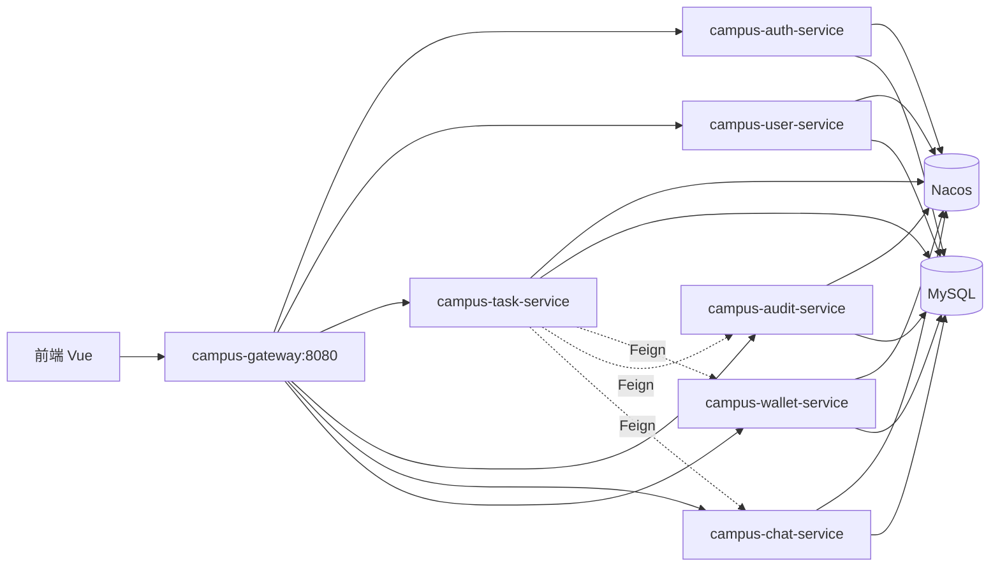

# 校园代拿微服务（Spring Cloud Alibaba）

基于 Nacos 服务发现、Spring Cloud Gateway 统一入口与 JWT 鉴权的微服务架构。

## 模块说明

| 模块 | 端口 | 职责 |
|------|------|------|
| campus-gateway | 8080 | 统一路由、JWT 鉴权、CORS |
| campus-auth-service | 8101 | 注册、登录、短信验证码 |
| campus-user-service | 8102 | 管理员用户/信誉分管理 |
| campus-task-service | 8103 | 任务发布、接单、AI 批量审核触发 |
| campus-audit-service | 8104 | 公告、操作日志、OpenAI 兼容 LLM（审核/智能客服） |
| campus-chat-service | 8105 | 聊天、WebSocket 实时推送 |
| campus-wallet-service | 8106 | 钱包、提现审核 |

公共库：

- `campus-common`：JWT、Feign 客户端、网关透传用户头
- `campus-persistence`：实体、Repository、DTO、Flyway（仅在 auth 服务启用迁移）

## 前置条件

1. JDK 17+
2. Maven 3.9+
3. MySQL 数据库 `campus_delivery`（配置见 `campus-common` 内 `application-campus-shared.yml`）
4. Nacos 3.x 本机地址默认 `127.0.0.1:8081`（控制台 http://127.0.0.1:8081/）

```bash
cd deploy
docker compose up -d
```

## 编译与启动

```bash
cd campus-cloud
mvn -q -DskipTests package
```

按顺序启动（均需 Nacos 已就绪）：

1. `campus-auth-service`
2. `campus-user-service`、`campus-wallet-service`、`campus-audit-service`、`campus-chat-service`
3. `campus-task-service`
4. `campus-gateway`

前端 `.env.development` 保持：

```
VITE_API_ORIGIN=http://localhost:8080
```

所有 `/api/**` 请求经网关转发，WebSocket 经 `ws://localhost:8080/ws`。

## 架构示意



## 云服务器部署

见 `deploy/云服部署说明.txt`，含 Nginx（`/api` + `/ws`）、`docker-compose.yml`、Linux `start-services.sh`。

## 说明

- 当前各服务共享同一 MySQL 库，适合课程/毕设演示；生产环境建议按域拆库并逐步去掉跨库依赖。
- 内部接口前缀 `/internal/**` 仅服务间调用，网关不对外暴露。
